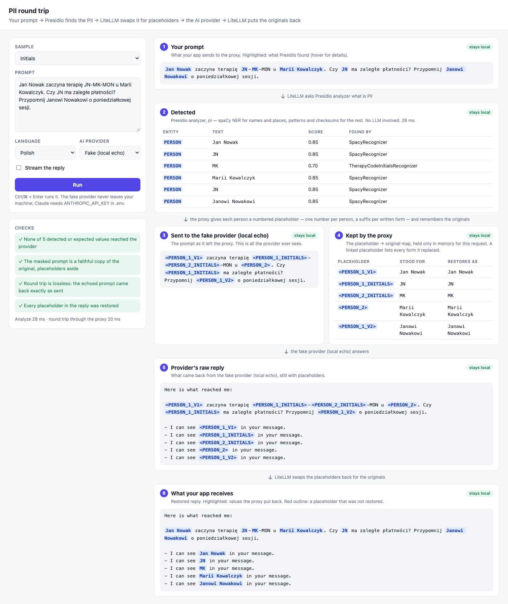

# anonimise-ai

Talk to an AI about real people without sending it their personal data.

A local proxy sits between your app and the AI provider. On the way out it replaces names,
initials, PESEL numbers, phone numbers, emails and IBANs with placeholders; on the way back it
puts the originals into the reply. The provider only ever sees `<PERSON_1>`, never "Jan Nowak" —
and your app gets back a normal answer with the real names in it.

Built from [LiteLLM](https://github.com/BerriAI/litellm) and
[Presidio](https://github.com/data-privacy-stack/presidio), with Polish support and one addition
neither has: **every mention of one person gets the same placeholder number**, so the AI knows
that "Jan Nowak", "Janowi Nowakowi" and "JN" are the same man, while the reply is still restored
word for word.



> **Status: proof of concept.** It runs entirely on your machine and is meant for evaluating the
> approach on your own data. Read [Limitations](#limitations) before trusting it with anything real.

## Contents

- [How it works](#how-it-works)
- [Quick start](#quick-start)
- [The web UI](#the-web-ui)
- [The command-line demo](#the-command-line-demo)
- [Using it from your own app](#using-it-from-your-own-app)
- [Using a real AI provider](#using-a-real-ai-provider)
- [Configuration](#configuration)
- [Limitations](#limitations)
- [Project layout](#project-layout)

## How it works

```
 your app ──────► LiteLLM proxy :4000 ──────────────► AI provider
     ▲              │   1 analyse      ▲   4 masked        │
     │              ▼                  │     prompt        │
     │       Presidio analyzer :5002   │                   │
     │       (spaCy NER, en + pl,      │                   │
     │        patterns, checksums)     │                   │
     │              │   2 findings     │                   │
     │              ▼                  │                   │
     │       3 one placeholder per person, map kept        │
     │         in memory for this request only             │
     │                                                     │
     └── 6 originals put back ◄── 5 reply with placeholders┘
```

1. **Your app** sends an ordinary chat request to the proxy, exactly as it would to OpenAI.
2. **Presidio's analyzer** reads the text and reports where the personal data is. Names and
   places come from [spaCy](https://spacy.io) language models (English and Polish, so inflected
   forms like *Jana Nowaka* are caught); PESEL, phone numbers, IBANs and emails from patterns
   and checksums. No chatbot is involved and nothing leaves the container.
3. **The proxy masks it.** Each finding becomes a placeholder, and the map from placeholder to
   original text is kept in memory for this one request.
4. **The AI provider** receives only the masked prompt.
5. **It answers** using the placeholders.
6. **The proxy restores the reply**, replacing every placeholder with the exact text it stood for.

### One person, one placeholder

LiteLLM's built-in Presidio integration numbers every finding separately, so three mentions of
one man reach the AI as three different people. This project replaces that numbering step
([`litellm/linked_presidio.py`](litellm/linked_presidio.py)): **the number says who, the suffix
says which form.**

| You wrote | The AI sees | Comes back as |
|---|---|---|
| Jan Nowak | `<PERSON_1_V1>` | Jan Nowak |
| Janowi Nowakowi | `<PERSON_1_V2>` | Janowi Nowakowi |
| JN | `<PERSON_1_INITIALS>` | JN |
| JN-MK-MON *(therapy code)* | `<PERSON_1_INITIALS>-<PERSON_2_INITIALS>-MON` | JN-MK-MON |
| Marii Kowalczyk | `<PERSON_2>` | Marii Kowalczyk |

- **Full names** are the same person when their words share a stem (*Nowak*, *Nowaka*,
  *Nowakowi*).
- **Initials** join a person only when they match exactly one full name in the text. Two people
  with the same initials stay separate rather than being guessed.
- A person written only one way keeps a plain `<PERSON_2>`. If the AI writes a bare
  `<PERSON_1>` on its own, it is restored as the shortest full form (usually the nominative,
  *Jan Nowak*).

The map from placeholder to real name only exists inside the proxy, for the length of one
request.

A spoken walkthrough of all of this is in [`docs/how-it-works.m4a`](docs/how-it-works.m4a)
(about six minutes; the script is [`docs/how-it-works.txt`](docs/how-it-works.txt)).

## Quick start

You need **Docker** (with Compose) and, for the command-line demo, **Node.js 22 or newer**.

```bash
git clone https://github.com/d-baranowski/anonimise-ai.git
cd anonimise-ai
docker compose up -d --build
```

The first build downloads the Polish spaCy model (about 500 MB) and takes a few minutes. When it
is done, open **http://localhost:4020**.

Nothing leaves your machine until you choose a real provider: the default "AI" is a local stand-in
that records what it was sent and echoes it back, so you can see exactly what a real provider
would receive.

To stop everything: `docker compose down`.

## The web UI

**http://localhost:4020** — pick a sample or type your own text, choose the language and the
provider, and press **Run** (or Ctrl/⌘ + Enter). Each run shows every stage of the round trip:

| Stage | What it shows |
|---|---|
| 1 · Your prompt | The text, with everything Presidio found highlighted (hover for score and source) |
| 2 · Detected | Each finding: type, text, confidence, which recogniser found it, overlaps |
| 3 · Sent to the provider | The masked prompt — all the provider ever sees |
| 4 · Kept by the proxy | Placeholder → every form it replaced → what it restores as |
| 5 · Provider's raw reply | The answer, still with placeholders |
| 6 · What your app receives | The restored answer, with the restored values highlighted |

On the left, checks tell you at a glance whether any detected or expected value reached the
provider, whether masking changed the rest of the text, whether the round trip was lossless, and
whether every placeholder was restored. Each stage is labelled *stays local* or *leaves your
network*.

## The command-line demo

The same pipeline in the terminal:

```bash
node demo.mjs                                    # every sample in samples.json
node demo.mjs initials same-person-twice         # chosen samples
node demo.mjs --text "Zadzwoń do Marka Nowaka" --lang pl
node demo.mjs --model claude                     # a real provider (see below)
node demo.mjs basic --stream                     # a streamed reply (see Limitations)
```

Add your own test cases to [`samples.json`](samples.json). `expect` lists values that must never
reach the provider; the demo and the UI flag any that do.

## Using it from your own app

The proxy speaks the OpenAI chat-completions API on **http://localhost:4000** with the key
`sk-poc-local`. Masking is on for every request — a caller cannot forget it.

```bash
curl http://localhost:4000/v1/chat/completions \
  -H "Authorization: Bearer sk-poc-local" \
  -H "Content-Type: application/json" \
  -d '{
    "model": "claude",
    "messages": [{"role": "user", "content": "Napisz przypomnienie dla Jana Nowaka (JN-MK-MON)."}],
    "guardrail_config": {"presidio-linked": {"language": "pl"}}
  }'
```

With the OpenAI SDK, point it at the proxy:

```js
import OpenAI from 'openai';

const ai = new OpenAI({ baseURL: 'http://localhost:4000/v1', apiKey: 'sk-poc-local' });

const reply = await ai.chat.completions.create({
  model: 'claude', // or 'fake' for the local echo
  messages: [{ role: 'user', content: 'Czy JN ma zaległe płatności? To Jan Nowak.' }],
  // Language of the text, for name detection. Defaults to Polish.
  guardrail_config: { 'presidio-linked': { language: 'pl' } },
});

console.log(reply.choices[0].message.content); // real names, restored by the proxy
```

Use non-streamed requests for now — see [Limitations](#limitations).

## Using a real AI provider

Claude is wired in already. Create a `.env` next to `docker-compose.yml`:

```bash
ANTHROPIC_API_KEY=sk-ant-...
```

then `docker compose up -d` and choose **Claude** in the UI, or `model: "claude"` from your app.
Requests go through a small recording tap on their way to Anthropic, which is how the UI can show
you exactly what Anthropic received and returned. With Claude selected, the masked prompt really
is sent to Anthropic.

Any other provider LiteLLM supports (OpenAI, Azure, Bedrock, Gemini, Ollama, …) can be added to
`model_list` in [`litellm/config.yaml`](litellm/config.yaml); see
[LiteLLM's provider docs](https://docs.litellm.ai/docs/providers). The masking applies to them
too.

## Configuration

| What | Where |
|---|---|
| Models, API keys, the proxy key | [`litellm/config.yaml`](litellm/config.yaml) |
| Default language (`presidio_language`) | [`litellm/config.yaml`](litellm/config.yaml), or per request via `guardrail_config` |
| How mentions are linked and numbered | [`litellm/linked_presidio.py`](litellm/linked_presidio.py) |
| Language models and entity mapping | [`analyzer/conf/nlp.yaml`](analyzer/conf/nlp.yaml) |
| Supported languages | [`analyzer/conf/analyzer.yaml`](analyzer/conf/analyzer.yaml) |
| Pattern recognisers (PESEL, phone, IBAN, therapy codes, …) | [`analyzer/conf/recognizers.yaml`](analyzer/conf/recognizers.yaml) |

**Adding a recogniser.** Anything with a recognisable shape can be added as a pattern in
`analyzer/conf/recognizers.yaml`, for example an internal client number:

```yaml
  - name: ClientNumberRecognizer
    type: custom
    supported_language: pl
    supported_entity: CLIENT_NUMBER
    patterns:
      - name: client_number
        regex: "\\bKL-\\d{6}\\b"
        score: 0.9
```

Then `docker compose up -d --build presidio-analyzer`. See Presidio's
[recogniser docs](https://presidio.dataprivacystack.org/analyzer/adding_recognizers/) for
deny-lists, context words and checksum validation.

**Adding a language.** Install its spaCy model in [`analyzer/Dockerfile`](analyzer/Dockerfile),
add it to `nlp.yaml` (mapping the model's entity labels to Presidio's) and to `supported_languages`
in `analyzer.yaml` and `recognizers.yaml`.

### Services and ports

| Service | Port | What it is |
|---|---|---|
| `webui` | 4020 | The web UI |
| `litellm` | 4000 | The proxy your app talks to |
| `presidio-analyzer` | 5002 | Finds personal data (spaCy + patterns), English and Polish |
| `presidio-anonymizer` | 5001 | Presidio's anonymiser, called by LiteLLM |
| `fake-llm` | 4010 | The local stand-in AI, and the recording tap in front of Anthropic |

## Limitations

- **Detection is statistical.** Names are found by a language model; it caught every name in the
  samples, including inflected forms and nicknames, but it will miss some in real text, and a
  missed name goes to the provider as written. Measure it on your own data before relying on it.
- **Streaming is broken in LiteLLM.** A streamed reply is restored and then masked again by a
  second pass, so the app receives `<PERSON>`. Streams are also buffered into one chunk, so there
  is no token-by-token output. Use non-streamed requests.
- **Organisation names are not masked.** The Polish model kept tagging things like the day in a
  therapy code as an organisation, so — like Presidio's own default — organisations are off.
- **Linking is a heuristic.** Matching names by shared stems works for Polish surnames, but it is
  not a grammar engine: unusual names can fail to link, and two different people with very
  similar names could be linked.
- **Restoring is exact text replacement.** If the AI alters a placeholder (writes `<PERSON 1>`),
  it is not restored.
- **Overlapping findings.** LiteLLM's built-in numbering garbles text when two findings overlap
  (an email that also matches as a URL); this project resolves overlaps first, keeping the
  longer finding.
- **It is a proof of concept.** The proxy key is fixed, the UI has no authentication, and the
  recording tap keeps the last exchange in memory. Do not expose these ports beyond your machine.

## Project layout

```
analyzer/            Presidio analyzer image: Polish model and recogniser config
litellm/             LiteLLM config and linked_presidio.py, the one-placeholder-per-person masking
fake-llm/            Local stand-in AI, and the recording tap in front of Anthropic
webui/               The web UI (no dependencies: a small Node server and one HTML page)
demo.mjs             The command-line demo
samples.json         Test prompts and the values each must never leak
docs/                Screenshot, and the spoken walkthrough with its script
```

Pinned versions: LiteLLM `v1.103.2`, Presidio `2.2.364`, spaCy model `pl_core_news_lg 3.8.0`,
Node `22.20.0`.

## License

[MIT](LICENSE)
